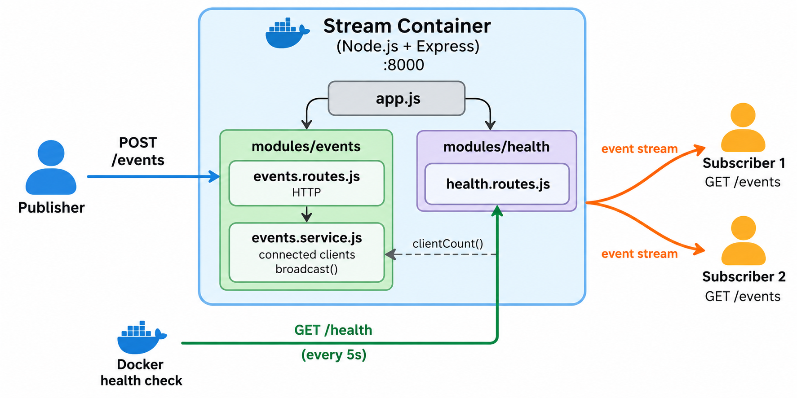

# Modular Streaming Service

## Introduction

In the **Async Patterns & Backpressure** lab, you streamed one big response: a CSV export that started, flowed and ended. Some streams never really end. A live feed of notifications, chat messages or stock prices keeps a connection open and pushes new data the moment it happens.

In this lab, you'll build a small **live event service**. Clients subscribe once and keep the connection open. Whenever anyone publishes a message, every subscriber receives it instantly, over that same open connection. You'll also give the service two things every deployable service needs:

- **A modular structure.** Each feature lives in its own folder, and the code that handles HTTP is kept separate from the logic behind it. Adding a feature later means adding a folder, not untangling one big file.
- **A health endpoint.** `GET /health` tells anyone asking (Docker, a load balancer, you) whether the service is up. Docker will check it automatically.

By the end, you'll have the service running in a container that Docker reports as **healthy**.



## Objectives

By the end of this lab, you will be able to:

- Explain how Server-Sent Events push data over one open HTTP response, and how that differs from polling.
- Build a subscribe-and-publish event stream with Express.
- Organize a service into feature modules, with routes (HTTP) kept separate from services (logic), and `app.js` kept separate from `server.js`.
- Clean up long-lived connections when clients disconnect, and recognize the leak that happens otherwise.
- Write a health endpoint, and have Docker check it automatically with a Compose healthcheck.

## Concepts

### Server-Sent Events: one response that stays open

A normal HTTP request is a phone call that ends as soon as you have your answer. To get new messages, a client would have to call again and again ("anything new? anything new?"), which is called **polling**. Most calls find nothing, and a new message waits until the next call.

**Server-Sent Events (SSE)** work more like a radio: the client tunes in once, and the server broadcasts whenever it has something to say. Technically, it's a single HTTP response that the server never finishes. It sets the header `Content-Type: text/event-stream` and then, every time there's news, writes an event in a simple text format:

```
id: 1
data: {"id":1,"message":"hello"}

```

Each event is one or more `field: value` lines, followed by an empty line that marks the end of the event. Browsers support SSE natively (the `EventSource` API), and `curl -N` shows the events as they arrive.

### A modular structure

Instead of one big `server.js`, the code is split up by feature:

```
src/
├── app.js                    builds the app and plugs in each module
├── server.js                 starts listening on a port
└── modules/
    ├── events/
    │   ├── events.routes.js  HTTP: subscribe and publish
    │   └── events.service.js logic: who's connected, broadcast to them
    └── health/
        └── health.routes.js  HTTP: is the service healthy?
```

Two splits are worth noticing:

- **Routes vs. service.** `events.routes.js` deals with HTTP: headers, request bodies, status codes. `events.service.js` holds the logic (the list of connected clients, and sending a message to all of them) and knows nothing about Express. Each file has one job, and other modules can use the service directly. The health module reads the client count from it.
- **`app.js` vs. `server.js`.** `app.js` *builds* the app, and `server.js` *starts* it. Keeping them apart means a test can load the app without opening a real port. You'll use that in the next lab.

### Health checks

A process can be running and still be broken: stuck, out of memory, or unable to reach its database. A **health endpoint** is a route whose only job is to answer "are you OK?" with `200` when the service can do its work. Docker can call it on a schedule and mark the container `healthy` or `unhealthy`. A load balancer can stop sending traffic to an instance that fails it.

### Cleaning up after clients leave

An open stream holds resources on the server: the connection, and an entry in the list of clients to send to. Clients leave all the time (they close a tab, lose Wi-Fi, press `Ctrl+C`), and they don't say goodbye first. The server has to notice when a connection closes and stop tracking it. Otherwise dead clients pile up forever. You'll break this on purpose in Step 5.

## Step 1: Create the project

**Run in the VM terminal:**

```bash
mkdir -p ~/code/streaming-service/src/modules/events ~/code/streaming-service/src/modules/health
cd ~/code/streaming-service
```

`mkdir -p` creates the whole folder path at once, including the module folders.

Open the folder in the VS Code editor (**File → Open Folder → `/home/poridhian/code/streaming-service`**). Create every file in this lab with the editor.

Create **`package.json`**:

```json
{
  "name": "streaming-service",
  "scripts": {
    "start": "node src/server.js",
    "dev": "node --watch src/server.js"
  },
  "type": "module",
  "dependencies": {
    "express": "5.3.0"
  }
}
```

This service has no database, so Express is the only dependency. The port defaults to 8000 in the code, so no `.env` file is needed either.

```bash
npm install
```

```
added 65 packages, and audited 66 packages in 6s

29 packages are looking for funding
  run `npm fund` for details

found 0 vulnerabilities
```

npm may also print a notice that a newer npm version is available. You can ignore it.

## Step 2: Start with the health module

Start with the simplest module. Create **`src/modules/health/health.routes.js`**:

```javascript
import { Router } from 'express';
import { clientCount } from '../events/events.service.js';

export const router = Router();

// Answers "is this service up, and how is it doing?"
router.get('/', (req, res) => {
  res.json({
    status: 'ok',
    uptimeSeconds: Math.round(process.uptime()),
    connectedClients: clientCount(),
  });
});
```

- The route is `'/'` here. `app.js` decides that this router lives at `/health`, so the module doesn't need to know its own address.
- `process.uptime()` is how many seconds the process has been running.
- `connectedClients` comes from the events service, which you'll write in Step 3. This is one module using another through a plain exported function.

The health module imports the events service, so create that file now. It's filled in during Step 3. Create **`src/modules/events/events.service.js`** with this temporary content:

```javascript
export function clientCount() {
  return 0;
}
```

Create **`src/app.js`**:

```javascript
import express from 'express';
import { router as healthRouter } from './modules/health/health.routes.js';

// Builds the app: middleware, one router per module, error handling.
// It doesn't start listening; server.js does that.
export const app = express();

app.use(express.json());

app.use('/health', healthRouter);

app.use((req, res) => {
  res.status(404).json({ error: 'route not found' });
});

app.use((err, req, res, next) => {
  if (err.type === 'entity.parse.failed') {
    return res.status(400).json({ error: 'request body is not valid JSON' });
  }
  console.error(err);
  res.status(500).json({ error: 'internal server error' });
});
```

`app.js` is the one place where modules are plugged in: `app.use('/health', healthRouter)` mounts the health router at `/health`. The rest is the same "not found" and error handling as in the **Express CRUD Service** lab.

Create **`src/server.js`**:

```javascript
import { app } from './app.js';

const port = Number(process.env.PORT ?? 8000);

// Express 5 passes startup errors (such as the port being taken) to this callback.
app.listen(port, (err) => {
  if (err) throw err;
  console.log(`streaming service listening on port ${port}`);
});
```

That's all `server.js` does: take the finished app and start it on a port.

Open a **second terminal** (**Terminal → New Terminal**) and start the service in watch mode.

**Run in the second terminal:**

```bash
cd ~/code/streaming-service && npm run dev
```

```
> dev
> node --watch src/server.js

streaming service listening on port 8000
```

Back in the **first terminal**, ask the service how it's doing:

```bash
curl -sS localhost:8000/health; echo
```

```
{"status":"ok","uptimeSeconds":27,"connectedClients":0}
```

## Step 3: Write the events service

Now the logic behind the live feed. Replace the temporary content of **`src/modules/events/events.service.js`** with:

```javascript
// Keeps track of connected clients and sends each event to all of them.
// It knows nothing about routes or requests: a client is anything with write().
const clients = new Set();
let nextId = 1;

export function addClient(client) {
  clients.add(client);
}

export function removeClient(client) {
  clients.delete(client);
}

export function clientCount() {
  return clients.size;
}

export function broadcast(message) {
  const event = { id: nextId++, message, sentAt: new Date().toISOString() };
  for (const client of clients) {
    client.write(`id: ${event.id}\ndata: ${JSON.stringify(event)}\n\n`);
  }
  return event;
}
```

- **`clients`** is a `Set` of every connected client. A `Set` makes adding and removing a specific client simple, and never holds the same client twice.
- **`broadcast`** builds an event with an increasing `id` and a timestamp, then writes it to every client in the SSE format: an `id:` line, a `data:` line holding the event as JSON, and an empty line (`\n\n`) to end the event.
- **No Express here.** A "client" is just something with a `write()` method. In practice it's an HTTP response, but the service doesn't need to know that.

The state lives in memory, inside this one process. That's fine for one instance. If you ran three copies of the service, each would have its own separate set of clients, and a message published to one copy would only reach that copy's subscribers. Real systems solve this with a shared message broker, which a later module covers.

## Step 4: Add the events routes and watch messages stream live

Create **`src/modules/events/events.routes.js`**:

```javascript
import { Router } from 'express';
import { addClient, removeClient, clientCount, broadcast } from './events.service.js';

export const router = Router();

// Subscribe: keep the response open and send every event as it happens.
router.get('/', (req, res) => {
  res.set({
    'Content-Type': 'text/event-stream',
    'Cache-Control': 'no-cache',
    Connection: 'keep-alive',
  });
  res.flushHeaders();
  res.write(`data: ${JSON.stringify({ message: 'connected' })}\n\n`);

  addClient(res);
  // When the client disconnects, stop sending to it.
  res.on('close', () => removeClient(res));
});

// Publish: send a message to every connected client.
router.post('/', (req, res) => {
  const message = req.body?.message;
  if (typeof message !== 'string' || message.trim() === '') {
    return res.status(400).json({ error: 'message is required' });
  }

  const event = broadcast(message.trim());
  res.status(201).json({ ...event, deliveredTo: clientCount() });
});
```

How subscribing works:

- **The headers** tell the client this is an event stream (`text/event-stream`), that it must not be cached (`no-cache`), and that the connection stays open (`keep-alive`).
- **`res.flushHeaders()`** sends the status and headers right away, so the client knows it's connected before any event exists.
- **The handler never calls `res.end()`.** It writes a first `connected` event, hands the response to the service with `addClient(res)`, and returns. The response stays open, and the service writes to it later whenever there's a broadcast.
- **`res.on('close', ...)`** runs when the connection closes, for whatever reason, and removes the client from the set. This is the cleanup from the Concepts section.

Publishing is an ordinary request: it validates `message`, broadcasts it, and answers `201` with the event and how many clients it was delivered to.

Plug the module in. In **`src/app.js`**, add this import below the health import:

```javascript
import { router as eventsRouter } from './modules/events/events.routes.js';
```

and this line below `app.use('/health', healthRouter);`:

```javascript
app.use('/events', eventsRouter);
```

Save. The dev server restarts. Now you need two subscribers. Open a **third terminal** and subscribe.

**Run in the third terminal:**

```bash
curl -sSN localhost:8000/events
```

`-N` turns off curl's output buffering, so each event appears the moment it arrives. You'll see the first event, and then curl keeps waiting: the response is still open.

```
data: {"message":"connected"}
```

Open a **fourth terminal** (or split the third one with the split icon in the terminal panel) and run the same command there. Now two clients are subscribed. Back in the **first terminal**, check the health endpoint, then publish a message:

```bash
curl -sS localhost:8000/health; echo
curl -sS -X POST localhost:8000/events -H 'Content-Type: application/json' \
  -d '{"message":"hello, subscribers"}' -w '\nHTTP %{http_code}\n'
```

<!-- From a local run with two subscribers (the VM run used one: same output with 1 and deliveredTo 1) -->
```
{"status":"ok","uptimeSeconds":45,"connectedClients":2}
{"id":1,"message":"hello, subscribers","sentAt":"2026-10-24T03:46:53.074Z","deliveredTo":2}
HTTP 201
```

Look at the third and fourth terminals. The message appeared in both at the same moment:

```
data: {"message":"connected"}

id: 1
data: {"id":1,"message":"hello, subscribers","sentAt":"2026-10-24T03:46:53.074Z"}

```

Publish a few more messages and watch them arrive. Each one travels over the connection that's already open; nobody asks for it.

Now press `Ctrl+C` in the **fourth terminal** to disconnect one subscriber, and check the health endpoint again:

```bash
curl -sS localhost:8000/health; echo
```

```
{"status":"ok","uptimeSeconds":71,"connectedClients":1}
```

Down to 1: the `close` handler removed the client that left. Finally, check that publishing validates its input:

```bash
curl -sS -X POST localhost:8000/events -H 'Content-Type: application/json' \
  -d '{"message":""}' -w '\nHTTP %{http_code}\n'
```

```
{"error":"message is required"}
HTTP 400
```

## Step 5: Break it on purpose

What does that one `res.on('close', ...)` line really do? Remove it and find out.

In **`src/modules/events/events.routes.js`**, comment out the cleanup line:

```javascript
  // res.on('close', () => removeClient(res));
```

Save, and let the dev server restart. Restarting closes every open connection, so the subscriber in the third terminal ends with this message (press `Ctrl+C` there if curl is still waiting):

```
curl: (18) transfer closed with outstanding read data remaining
```

That's expected. An event stream has no natural end, so when the server goes away, curl reports that the response was cut off.

In the **third terminal**, connect and disconnect three times: run `curl -sSN localhost:8000/events`, press `Ctrl+C`, and repeat. Then, in the **first terminal**, check health and publish:

```bash
curl -sS localhost:8000/health; echo
curl -sS -X POST localhost:8000/events -H 'Content-Type: application/json' \
  -d '{"message":"anyone there?"}' -w '\nHTTP %{http_code}\n'
```

```
{"status":"ok","uptimeSeconds":120,"connectedClients":3}
{"id":1,"message":"anyone there?","sentAt":"2026-10-24T04:13:18.476Z","deliveredTo":3}
HTTP 201
```

Nobody is connected, yet the service reports **3 clients**, and the publish claims it delivered to all 3. The three dead connections were never removed, so the service keeps writing to them. Nothing crashes, which is what makes this kind of bug dangerous. On a real service with thousands of clients coming and going, the set grows without limit, memory climbs, every broadcast wastes work on dead connections, and the health endpoint reports numbers that aren't true.

Remove the `//` again and save. The dev server restarts with an empty client list. Connect and disconnect once more, and `connectedClients` correctly goes back to `0`.

## Step 6: Run the service in a container, with a health check

Stop the dev server: press `Ctrl+C` in the **second terminal**. Also stop any subscriber that's still running. Check that port 8000 is free:

```bash
ss -tln | grep -q ':8000 ' && echo "port 8000 is still in use" || echo "port 8000 is free"
```

```
port 8000 is free
```

Create **`Dockerfile`**:

```dockerfile
FROM node:24-slim

WORKDIR /app

# Copy the dependency list first so this layer is cached between code changes.
COPY package.json package-lock.json ./
RUN npm ci --omit=dev

COPY src ./src

EXPOSE 8000
CMD ["node", "src/server.js"]
```

This is the same Dockerfile as in the **Express CRUD Service** lab. Create **`.dockerignore`**:

```
node_modules
```

Create **`docker-compose.yml`**:

```yaml
services:
  stream:
    build: .
    environment:
      PORT: 8000
    ports:
      - "8000:8000"
    healthcheck:
      test: ["CMD", "node", "-e", "fetch('http://localhost:8000/health').then((r) => process.exit(r.ok ? 0 : 1)).catch(() => process.exit(1))"]
      interval: 5s
      timeout: 3s
      retries: 5
```

The new part is the **healthcheck**, which makes Docker call your health endpoint:

- `test` is the command Docker runs inside the container. The `node:24-slim` image has no `curl`, so the check uses Node itself: `fetch` calls `/health`, and the process exits with `0` (healthy) if the response is OK, or `1` (unhealthy) if it isn't or the request fails.
- `interval: 5s` runs the check every 5 seconds, and `timeout: 3s` counts a check that takes longer as failed.
- `retries: 5` marks the container `unhealthy` after 5 failures in a row.

Build and start it. `--wait` now waits for more than "the container started": it waits until the healthcheck passes.

```bash
docker compose up -d --build --wait
```

```
[+] up 3/3
 ✔ Image streaming-service-stream       Built          11.7s
 ✔ Network streaming-service_default    Created         0.0s
 ✔ Container streaming-service-stream-1 Healthy         5.8s
```

```bash
docker compose ps
```

```
NAME                         IMAGE                      COMMAND                  SERVICE   CREATED         STATUS                   PORTS
streaming-service-stream-1   streaming-service-stream   "docker-entrypoint.s…"   stream    8 seconds ago   Up 7 seconds (healthy)   0.0.0.0:8000->8000/tcp, [::]:8000->8000/tcp
```

`(healthy)` means Docker called `/health` and got a good answer. To see the checks Docker has run:

```bash
docker inspect --format '{{json .State.Health}}' streaming-service-stream-1 | jq
```

`docker inspect` shows a container's full state. `--format '{{json .State.Health}}'` picks out just the health part as JSON, and `jq` prints it readably.

```json
{
  "Status": "healthy",
  "FailingStreak": 0,
  "Log": [
    {
      "Start": "2026-10-24T04:15:51.419306858Z",
      "End": "2026-10-24T04:15:51.702394939Z",
      "ExitCode": 0,
      "Output": ""
    },
    {
      "Start": "2026-10-24T04:15:56.704537966Z",
      "End": "2026-10-24T04:15:56.951988581Z",
      "ExitCode": 0,
      "Output": ""
    },
    ...
  ]
}
```

(Trimmed: Docker keeps the last five checks.) Each entry in `Log` is one check: they run 5 seconds apart, as `interval: 5s` asked, and `ExitCode: 0` means the check passed. `FailingStreak: 0` means no recent check has failed.

Now the same live test against the container. Subscribe in the **third terminal**:

```bash
curl -sSN localhost:8000/events
```

and publish from the **first terminal**:

```bash
curl -sS -X POST localhost:8000/events -H 'Content-Type: application/json' \
  -d '{"message":"hello from the container"}' -w '\nHTTP %{http_code}\n'
```

```
{"id":1,"message":"hello from the container","sentAt":"2026-10-24T04:17:07.066Z","deliveredTo":1}
HTTP 201
```

The message appears in the third terminal, the same as before. The service is now a self-contained, deployable unit: anyone with Docker can run it with one command, and Docker tells them whether it's healthy.

Finally, stop it, with the subscriber in the third terminal still connected, and time how long that takes:

```bash
time docker compose down
```

```
[+] down 2/2
 ✔ Container streaming-service-stream-1 Removed         10.3s
 ✔ Network streaming-service_default    Removed          0.1s

real    0m10.588s
user    0m0.175s
sys     0m0.086s
```

`time` runs a command and reports how long it took. `real` is the wall-clock time.

About **10 seconds** to stop a tiny service. Docker asked the process to stop (it sent `SIGTERM`), but the service has no code that listens for that signal, so it just kept running. After 10 seconds, Docker gave up and killed it (`SIGKILL`), cutting off the subscriber mid-stream: the third terminal shows `curl: (18) transfer closed with outstanding read data remaining`. Handling that signal properly, so the service shuts down cleanly and quickly, is part of the next lab.

## Conclusion

You built a live event service and made it deployable:

- **Server-Sent Events.** A subscriber opens one HTTP response that never ends, and the server writes each new event into it the moment it happens. No polling, and no new request per message.
- **A modular structure.** Each feature lives in its own module folder. The routes handle HTTP and the service holds the logic. `app.js` plugs the modules in, and `server.js` only starts the app. The health module used the events service through a plain function, with no HTTP in between.
- **Cleanup matters for long-lived connections.** Without `res.on('close', ...)`, disconnected clients stayed in memory forever, and the service reported clients that didn't exist.
- **A health endpoint Docker uses.** The Compose healthcheck calls `/health` every 5 seconds, `docker compose up --wait` waits until it passes, and `docker compose ps` shows `(healthy)`.
- **One loose end:** stopping the container took 10 seconds, because the service ignores Docker's stop signal.

In the **Production-Shaped Service** lab, you'll combine the CRUD API, the async patterns and this streaming module into one service, with graceful shutdown and a smoke-test suite.
