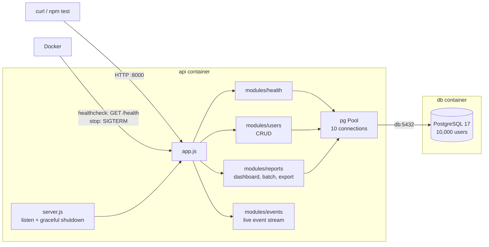

# Production-Shaped Service

## Introduction

Over the last three labs you built three separate pieces:

- the **Express CRUD Service**: a users API backed by PostgreSQL, with validation and proper status codes,
- the **Async Patterns & Backpressure** handlers: a parallel dashboard, a concurrency-limited batch job and a streamed export,
- the **Modular Streaming Service**: a live event feed with a module structure and a health endpoint.

Real services aren't three separate apps. In this lab, which is a **task** rather than a guided walkthrough, you'll combine all three into **one deployable service**, and add what turns it into something you could run in production:

- **One module structure** that holds every feature.
- **A health endpoint that tells the truth**: healthy only when the service can actually serve requests.
- **Graceful shutdown**: when Docker stops the service, it finishes what it's doing, closes everything cleanly, and exits in under a second instead of being killed after 10.
- **A smoke-test suite** that proves every capability works, with one command.

You get a working starting point: a service skeleton with its Docker setup already done, plus the code from the earlier labs to copy from. Each task below says what to build and how to check it. Every task also has a hint and a full solution in collapsible blocks. Try it yourself first. AI tools are allowed: if you use one, make sure you understand and can explain what it wrote.



## Concepts

### Graceful shutdown

Every deploy, scale-down and `docker compose stop` stops your service. Docker does it in two stages: it sends the process the **`SIGTERM`** signal ("please stop"), waits up to 10 seconds, and then sends **`SIGKILL`**, which can't be caught and kills the process instantly. You saw the result of ignoring `SIGTERM` in the **Modular Streaming Service** lab: a 10-second wait, then open connections cut off mid-stream.

A **graceful shutdown** listens for `SIGTERM` and closes down in order:

1. **Stop accepting new connections.** `server.close()` does this. Its callback runs once every connection that's already open has finished.
2. **Finish what's in progress.** Normal requests finish by themselves within milliseconds. Long-lived ones, like event streams, never finish on their own, so the service ends them itself.
3. **Release resources**, such as the database pool (`pool.end()`).
4. **Exit with code `0`**, meaning "stopped cleanly".

Plus a **safety net**: a timer that forces the process to exit if any of this hangs, so it exits on its own terms before Docker's `SIGKILL` arrives.

### A health check that tells the truth

In the **Modular Streaming Service** lab, `/health` answered `ok` as long as the process was running. But a service whose database is unreachable can't serve users, even though its process is running fine. A truthful health check asks: *can this instance do its job right now?*

- It runs a trivial query (`SELECT 1`) and answers `503 Service Unavailable` if the database doesn't respond.
- It answers `503` as soon as shutdown begins, so a load balancer stops sending new traffic to an instance that's about to leave.

### Smoke tests

A **smoke test** is a quick check that the main paths work at all, like switching on a new device to see that it powers up and nothing smokes. Here, the tests send real HTTP requests to the running stack with Node's built-in test runner (`node --test`) and `fetch`. No extra packages are needed. For each capability, you'll write one **happy path** test (it works when used correctly) and one **failure case** test (it rejects bad input properly).

## Getting started

**Run in the VM terminal.** Clone the starting point:

```bash
cd ~/code && git clone -b lab-04-start --depth 1 https://github.com/poridhioss/system-design-m5.git
cd ~/code/system-design-m5/labs/lab-04/app
```

- `-b lab-04-start` checks out the `lab-04-start` branch, which holds this lab's starting point.
- `--depth 1` downloads only the latest version of the files, not the project's whole history.

Open `~/code/system-design-m5` in the VS Code editor (**File → Open Folder**). This is your service, in `labs/lab-04/app`:

```
labs/lab-04/app/
├── docker-compose.yml        db + api, both with healthchecks (done)
├── Dockerfile                (done)
├── db/init.sql               users table with 10,000 sample users (done)
├── REFLECTION.md             Task 5
├── src/
│   ├── config.js             reads PORT, DATABASE_URL, SHUTDOWN_TIMEOUT_MS (done)
│   ├── db.js                 the connection pool (done)
│   ├── app.js                mounts the modules (Task 1)
│   ├── server.js             starts the service (Task 3)
│   └── modules/
│       └── health/           the health endpoint (Task 2)
└── test/
    └── smoke.test.js         one example test (Task 4)
```

The code from the earlier labs is right next to it, ready to copy from:

| Earlier lab | Code |
|---|---|
| **Express CRUD Service** | `labs/lab-01/app/src/users.js` |
| **Async Patterns & Backpressure** | `labs/lab-02/app/src/dashboard.js`, `report.js`, `export.js` |
| **Modular Streaming Service** | `labs/lab-03/app/src/modules/events/` |

Start the stack. It already runs: it just doesn't do much yet.

```bash
docker compose up -d --build --wait
```

<!-- UNTESTED -->
```
[+] up 5/5
 ✔ Image production-service-api       Built
 ✔ Network production-service_default Created
 ✔ Volume production-service_pgdata   Created
 ✔ Container production-service-db-1  Healthy
 ✔ Container production-service-api-1 Healthy
```

Run the smoke tests. The test file runs on the VM against the stack you just started:

```bash
npm test
```

<!-- UNTESTED -->
```
> test
> node --test

✔ health: the service reports ok (25.1ms)
ℹ tests 1
ℹ suites 0
ℹ pass 1
ℹ fail 0
...
```

One test, passing. By the end, there will be seven.

**Your work loop for every task:** edit the code, rebuild and restart the API container with `docker compose up -d --build --wait`, then check it with `curl` or `npm test`. To see what the service is printing, use `docker compose logs api`.

## Task 1: Bring in the three capabilities as modules

**Build these modules under `src/modules/`, and mount them in `src/app.js`:**

| Module | File | Mounted at | Routes |
|---|---|---|---|
| users | `users/users.routes.js` | `/users` | The five CRUD routes from the **Express CRUD Service** lab |
| reports | `reports/reports.routes.js` | `/reports` | `GET /dashboard/:id` (parallel queries), `GET /batch` (200 lookups, at most 3 at a time), `GET /export` (streamed CSV) |
| events | `events/events.routes.js` and `events/events.service.js` | `/events` | Subscribe and publish, from the **Modular Streaming Service** lab |

For the reports module, keep only the good version of each pattern ("after", not "before"), and drop the `pg_sleep` delays: they were only there to make the timings visible.

**Check it:**

```bash
docker compose up -d --build --wait
curl -sS -X POST localhost:8000/users -H 'Content-Type: application/json' \
  -d '{"name":"Ada Lovelace","email":"ada@example.com"}' -w '\nHTTP %{http_code}\n'
curl -sS localhost:8000/reports/dashboard/42; echo
curl -sS localhost:8000/reports/batch; echo
curl -sS localhost:8000/reports/export -o /tmp/export.csv && head -3 /tmp/export.csv
```

<!-- UNTESTED -->
```
{"id":10001,"name":"Ada Lovelace","email":"ada@example.com","created_at":"2026-10-24T05:20:11.482Z"}
HTTP 201
{"user":{"id":42,"name":"User 42","email":"user42@example.com"},"firstUser":{"id":1,"name":"User 1"},"newestUser":{"id":10001,"name":"Ada Lovelace"}}
{"users":200,"ms":40}
id,name,email
1,User 1,user1@example.com
2,User 2,user2@example.com
```

For the events module, subscribe in a second terminal with `curl -sSN localhost:8000/events`, and publish from the first terminal, as in the **Modular Streaming Service** lab.

<details>
<summary>Hint</summary>

- Copy each file into its module folder, then fix the imports: the pool is now at `../../db.js` relative to a module file.
- A router's routes are relative to where it's mounted. In `reports.routes.js`, write `router.get('/dashboard/:id', ...)`; mounted at `/reports`, it becomes `/reports/dashboard/:id`.
- The error handler in `app.js` is already complete. It combines the cases from all three labs: invalid JSON (`400`), duplicate email (`409`), a stream that fails after it has started, and everything else (`500`).
- The events files from the **Modular Streaming Service** lab can be copied as they are.

</details>

<details>
<summary>Solution: <code>src/modules/users/users.routes.js</code></summary>

Copy `labs/lab-01/app/src/users.js` to `src/modules/users/users.routes.js`. The only change is the pool import on line 2:

```javascript
import { pool } from '../../db.js';
```

</details>

<details>
<summary>Solution: <code>src/modules/reports/reports.routes.js</code></summary>

```javascript
import { Router } from 'express';
import pLimit from 'p-limit';
import QueryStream from 'pg-query-stream';
import { pipeline } from 'node:stream/promises';
import { pool } from '../../db.js';

export const router = Router();

// Dashboard: three independent queries, run in parallel with Promise.all.
router.get('/dashboard/:id', async (req, res) => {
  const id = Number(req.params.id);
  if (!Number.isInteger(id) || id <= 0) return res.status(400).json({ error: 'id must be a positive integer' });

  const [profile, first, newest] = await Promise.all([
    pool.query('SELECT id, name, email FROM users WHERE id = $1', [id]),
    pool.query('SELECT id, name FROM users ORDER BY id LIMIT 1'),
    pool.query('SELECT id, name FROM users ORDER BY id DESC LIMIT 1'),
  ]);
  if (profile.rows.length === 0) return res.status(404).json({ error: 'user not found' });

  res.json({
    user: profile.rows[0],
    firstUser: first.rows[0],
    newestUser: newest.rows[0],
  });
});

// Batch: look up 200 users, at most 3 queries at a time, so the pool stays free for others.
const limit = pLimit(3);
const USER_IDS = Array.from({ length: 200 }, (_, i) => i + 1);

router.get('/batch', async (req, res) => {
  const started = Date.now();
  const results = await Promise.all(
    USER_IDS.map((id) => limit(() => pool.query('SELECT id, name FROM users WHERE id = $1', [id])))
  );
  res.json({ users: results.length, ms: Date.now() - started });
});

// Export: stream every user as CSV, 1,000 rows at a time, with backpressure.
router.get('/export', async (req, res) => {
  const client = await pool.connect();
  try {
    const rows = client.query(new QueryStream('SELECT id, name, email FROM users ORDER BY id', [], { batchSize: 1000 }));
    res.type('text/csv');
    await pipeline(
      rows,
      async function* (source) {
        yield 'id,name,email\n';
        for await (const user of source) {
          yield `${user.id},${user.name},${user.email}\n`;
        }
      },
      res
    );
  } finally {
    client.release(); // always give the connection back, even if the client disconnects
  }
});
```

The dashboard also validates its `id` now. Without that check, a request like `/reports/dashboard/abc` would reach Postgres as an invalid number and come back as a `500`.

</details>

<details>
<summary>Solution: the events module and <code>src/app.js</code></summary>

Copy `labs/lab-03/app/src/modules/events/events.routes.js` and `events.service.js` into `src/modules/events/` unchanged.

Then, in `src/app.js`, replace the first `TODO` with these imports:

```javascript
import { router as usersRouter } from './modules/users/users.routes.js';
import { router as reportsRouter } from './modules/reports/reports.routes.js';
import { router as eventsRouter } from './modules/events/events.routes.js';
```

and the second `TODO` with:

```javascript
app.use('/users', usersRouter);
app.use('/reports', reportsRouter);
app.use('/events', eventsRouter);
```

</details>

## Task 2: Make the health check tell the truth

**Change `GET /health` so that it:**

- answers `503` with `{"status":"shutting down"}` once shutdown has started (you'll start shutdowns in Task 3, so for now, just make the check possible),
- answers `503` with `{"status":"database unavailable"}` if `SELECT 1` fails,
- otherwise answers `200` with `status: "ok"`, the uptime, and the number of connected event subscribers.

**Check it** by stopping the database while the API keeps running:

```bash
docker compose up -d --build --wait
curl -sS localhost:8000/health -w '\nHTTP %{http_code}\n'
docker compose stop db
curl -sS localhost:8000/health -w '\nHTTP %{http_code}\n'
docker compose up -d --wait
curl -sS localhost:8000/health -w '\nHTTP %{http_code}\n'
```

<!-- UNTESTED -->
```
{"status":"ok","uptimeSeconds":8,"connectedClients":0}
HTTP 200
{"status":"database unavailable"}
HTTP 503
{"status":"ok","uptimeSeconds":31,"connectedClients":0}
HTTP 200
```

The API process never stopped, but while the database was down, it honestly reported that it couldn't serve requests. Once the database was back, the pool reconnected by itself.

<details>
<summary>Hint</summary>

- The health module needs to know whether shutdown has started, but the shutdown code lives in `server.js`. Create a tiny shared module, `src/state.js`, that exports an object such as `{ shuttingDown: false }`. `server.js` sets the flag, and the health route reads it.
- Wrap `await pool.query('SELECT 1')` in `try/catch`, and answer `503` in the `catch`.
- `clientCount()` from the events service gives the number of subscribers.

</details>

<details>
<summary>Solution: <code>src/state.js</code> and <code>src/modules/health/health.routes.js</code></summary>

**`src/state.js`**:

```javascript
// Shared process state. server.js sets shuttingDown; the health module reads it.
export const state = {
  shuttingDown: false,
};
```

**`src/modules/health/health.routes.js`**:

```javascript
import { Router } from 'express';
import { pool } from '../../db.js';
import { state } from '../../state.js';
import { clientCount } from '../events/events.service.js';

export const router = Router();

// Healthy means "able to serve requests": not shutting down, and the database answers.
router.get('/', async (req, res) => {
  if (state.shuttingDown) {
    return res.status(503).json({ status: 'shutting down' });
  }
  try {
    await pool.query('SELECT 1');
  } catch {
    return res.status(503).json({ status: 'database unavailable' });
  }
  res.json({
    status: 'ok',
    uptimeSeconds: Math.round(process.uptime()),
    connectedClients: clientCount(),
  });
});
```

</details>

## Task 3: Shut down gracefully

**When the process receives `SIGTERM` (from Docker) or `SIGINT` (from `Ctrl+C`), it must:**

1. set the shutting-down flag, so `/health` answers `503`,
2. stop accepting new connections,
3. end every open event stream,
4. once all connections have closed, close the database pool and exit with code `0`,
5. if any of this takes longer than `config.shutdownTimeoutMs` (8 seconds), log it and exit with code `1`.

Log each stage, so the shutdown can be followed in `docker compose logs api`. A second signal during a shutdown should change nothing.

**Check it** with a live subscriber connected. Rebuild first:

```bash
docker compose up -d --build --wait
```

Subscribe in a **second terminal**:

```bash
curl -sSN localhost:8000/events
```

Then, in the **first terminal**, stop the API, timing it, and look at what happened:

```bash
time docker compose stop api
docker compose logs api --tail 4
docker compose ps -a api
```

`docker compose ps -a` also lists stopped containers, so you can see the exit code.

<!-- UNTESTED -->
```
[+] stop 1/1
 ✔ Container production-service-api-1 Stopped

real    0m0.6s

api-1  | SIGTERM received, shutting down
api-1  | all connections closed
api-1  | database pool closed, exiting
NAME                       IMAGE                    COMMAND                  SERVICE   CREATED          STATUS                     PORTS
production-service-api-1   production-service-api   "docker-entrypoint.s…"   api       2 minutes ago    Exited (0) 1 second ago
```

What to look for:

- **Under a second**, compared with 10 seconds in the **Modular Streaming Service** lab.
- **The three log lines, in order:** signal received, connections closed, pool closed.
- **`Exited (0)`**: a clean exit, not a kill.
- **The subscriber in the second terminal ended normally**, with no `transfer closed with outstanding read data remaining` error, because the server ended the stream properly instead of having it cut off.

Start the API again for the next task: `docker compose up -d --wait`.

<details>
<summary>Hint</summary>

- `process.on('SIGTERM', ...)` and `process.on('SIGINT', ...)` register signal handlers. Call the same `shutdown` function from both.
- `app.listen()` returns the server object. Keep it, because you need `server.close(callback)`.
- `server.close()` waits for open connections to finish, and an event stream never finishes by itself. Add a function to the events service that calls `end()` on every client and clears the set, and call it after `server.close()`.
- For the safety net, `setTimeout(...)` plus `.unref()`: `unref()` means "don't keep the process alive just for this timer", so the timer can't delay a clean exit.
- The `CMD ["node", "src/server.js"]` in the Dockerfile matters here: Node itself is the container's main process, so it receives Docker's `SIGTERM` directly.

</details>

<details>
<summary>Solution: <code>closeAllClients()</code> and <code>src/server.js</code></summary>

Add this function to the end of **`src/modules/events/events.service.js`**:

```javascript
// Ends every open stream. Used during shutdown: event streams never finish on their own.
export function closeAllClients() {
  for (const client of clients) {
    client.end();
  }
  clients.clear();
}
```

**`src/server.js`**:

```javascript
import { app } from './app.js';
import { config } from './config.js';
import { pool } from './db.js';
import { state } from './state.js';
import { closeAllClients } from './modules/events/events.service.js';

// Express 5 passes startup errors (such as the port being taken) to this callback.
const server = app.listen(config.port, (err) => {
  if (err) throw err;
  console.log(`service listening on port ${config.port}`);
});

async function shutdown(signal) {
  if (state.shuttingDown) return; // a second signal changes nothing
  state.shuttingDown = true;
  console.log(`${signal} received, shutting down`);

  // Safety net: if anything hangs, exit before Docker's 10-second SIGKILL.
  setTimeout(() => {
    console.error('shutdown took too long, forcing exit');
    process.exit(1);
  }, config.shutdownTimeoutMs).unref();

  // 1. Stop accepting new connections. The callback runs once every open one has finished.
  server.close(async () => {
    console.log('all connections closed');
    // 3. Close the database pool, then exit cleanly.
    await pool.end();
    console.log('database pool closed, exiting');
    process.exit(0);
  });

  // 2. Event streams never finish on their own, so end them now.
  closeAllClients();
}

process.on('SIGTERM', () => shutdown('SIGTERM'));
process.on('SIGINT', () => shutdown('SIGINT'));
```

The order matters. `server.close()` comes first, so no new connection can sneak in. Then the event streams are ended, which lets `server.close()` finish, and only then is the pool closed, because no request can still need it at that point.

</details>

## Task 4: Write the smoke tests

**In `test/smoke.test.js`, add one happy-path test and one failure-case test for each capability:**

| Capability | Happy path | Failure case |
|---|---|---|
| users (CRUD) | create a user (`201`), read it back (`200`), delete it (`204`) | an invalid user is rejected with `400` |
| reports (async patterns) | the dashboard of user 42 returns all three parts | the dashboard of a user that doesn't exist is `404` |
| events (streaming) | a subscriber receives a message that's published | an empty message is rejected with `400` |

With the existing health test, that's seven tests. The tests must clean up after themselves, and pass when run twice in a row.

**Check it:**

```bash
npm test
```

<!-- UNTESTED -->
```
> test
> node --test

✔ health: the service reports ok (229.281ms)
✔ users: create, read and delete a user (57.8938ms)
✔ users: an invalid user is rejected with 400 (3.2205ms)
✔ reports: the dashboard returns all three parts (51.2679ms)
✔ reports: the dashboard of a missing user is 404 (2.8307ms)
✔ events: a subscriber receives a published message (32.031ms)
✔ events: publishing an empty message is rejected with 400 (5.4793ms)
ℹ tests 7
ℹ suites 0
ℹ pass 7
ℹ fail 0
ℹ cancelled 0
ℹ skipped 0
ℹ todo 0
ℹ duration_ms 480.3099
```

<details>
<summary>Hint</summary>

- Use a unique email in the CRUD test, such as `` `smoke-${Date.now()}@example.com` ``, and delete the user at the end. Then the test passes however many times it runs.
- For the event test, `fetch('/events')` resolves as soon as the headers arrive, while the stream stays open. Read it with `res.body.getReader()`: the first `read()` is the `connected` event. Then publish a message, and keep reading until the text you've collected contains it.
- Use an `AbortController` to close the subscription at the end, and give the test a `{ timeout: 5000 }` option, so it fails instead of hanging forever if the message never arrives.
- Express adds `; charset=utf-8` to the `Content-Type` header, so match its start (`/^text\/event-stream/`) rather than comparing it exactly.

</details>

<details>
<summary>Solution: the tests to add to <code>test/smoke.test.js</code></summary>

Replace the `TODO` comment with:

```javascript
// --- CRUD (users) ---

test('users: create, read and delete a user', async () => {
  const email = `smoke-${Date.now()}@example.com`;
  const created = await fetch(`${BASE}/users`, {
    method: 'POST',
    headers: JSON_HEADERS,
    body: JSON.stringify({ name: 'Smoke Test', email }),
  });
  assert.equal(created.status, 201);
  const user = await created.json();

  const read = await fetch(`${BASE}/users/${user.id}`);
  assert.equal(read.status, 200);
  assert.equal((await read.json()).email, email);

  const deleted = await fetch(`${BASE}/users/${user.id}`, { method: 'DELETE' });
  assert.equal(deleted.status, 204);
});

test('users: an invalid user is rejected with 400', async () => {
  const res = await fetch(`${BASE}/users`, {
    method: 'POST',
    headers: JSON_HEADERS,
    body: JSON.stringify({ name: '', email: 'not-an-email' }),
  });
  assert.equal(res.status, 400);
});

// --- Async patterns (reports) ---

test('reports: the dashboard returns all three parts', async () => {
  const res = await fetch(`${BASE}/reports/dashboard/42`);
  assert.equal(res.status, 200);
  const body = await res.json();
  assert.equal(body.user.id, 42);
  assert.ok(body.firstUser && body.newestUser);
});

test('reports: the dashboard of a missing user is 404', async () => {
  const res = await fetch(`${BASE}/reports/dashboard/999999999`);
  assert.equal(res.status, 404);
});

// --- Streaming (events) ---

test('events: a subscriber receives a published message', { timeout: 5000 }, async () => {
  const subscription = new AbortController();
  const res = await fetch(`${BASE}/events`, { signal: subscription.signal });
  assert.match(res.headers.get('content-type'), /^text\/event-stream/);
  const reader = res.body.getReader();
  await reader.read(); // the "connected" event

  const message = `smoke ${Date.now()}`;
  const published = await fetch(`${BASE}/events`, {
    method: 'POST',
    headers: JSON_HEADERS,
    body: JSON.stringify({ message }),
  });
  assert.equal(published.status, 201);

  // Read the stream until the message arrives (the test times out if it never does).
  let received = '';
  while (!received.includes(message)) {
    received += new TextDecoder().decode((await reader.read()).value);
  }
  subscription.abort();
});

test('events: publishing an empty message is rejected with 400', async () => {
  const res = await fetch(`${BASE}/events`, {
    method: 'POST',
    headers: JSON_HEADERS,
    body: JSON.stringify({ message: '' }),
  });
  assert.equal(res.status, 400);
});
```

</details>

## Task 5: Write your reflection

Answer the two questions in **`REFLECTION.md`**, in 3–5 lines in total:

1. **Where did async/await and streams need different error handling?**
2. **What would break first under load?**

Think about what you saw in this module: the error handler's special case for streams, the `finally { client.release(); }` in the export, the cleanup on disconnect and at shutdown, and the pool queue from the **Async Patterns & Backpressure** lab.

<details>
<summary>A model answer</summary>

**1. Where did async/await and streams need different error handling?**

An async/await route fails before it responds, so the error is thrown, reaches the central error handler, and becomes a clean `400`/`500` JSON response. A stream can fail after the `200` and part of the body have already been sent, so the handler can only log it and close the connection, and `finally` must release the database connection. Event streams never end on their own, so they also need explicit cleanup on disconnect and at shutdown.

**2. What would break first under load?**

The 10-connection database pool: every export holds a connection for its whole duration, so a handful of slow exports or unbounded `Promise.all` batches leave other requests queuing for a connection. Next, the in-memory list of event subscribers, which lives in one process and can't be shared across several instances.

</details>

## Final check

Your service is done when this whole sequence works from a clean start:

```bash
docker compose down -v
docker compose up -d --build --wait
npm test
time docker compose stop api
docker compose logs api --tail 4
docker compose ps -a api
```

- `docker compose down -v` removes the containers *and* the database volume, so everything starts fresh.
- `up` must end with both containers `Healthy`.
- `npm test` must show `pass 7` and `fail 0`.
- `stop` must take about a second, the logs must show the three shutdown stages in order, and the container must show `Exited (0)`.

That's the deliverable: one Compose stack running all three capabilities, a test file that covers each of them, and your reflection.

## Conclusion

You turned three separate labs into one service that's shaped for production:

- **One module structure.** `users`, `reports`, `events` and `health` each live in their own folder. `app.js` plugs them in, and `server.js` owns the process lifecycle.
- **A truthful health check.** It answers `503` when the database is unreachable or the service is shutting down, so Docker and load balancers only send traffic to an instance that can handle it.
- **Graceful shutdown.** On `SIGTERM`, the service stops taking connections, ends its event streams, closes the pool and exits cleanly in under a second, with a safety net in case anything hangs.
- **Smoke tests.** Seven tests, a happy path and a failure case per capability, prove the whole stack works with one command.

Together with the earlier labs, you've now covered the whole module: the event loop and async/await, data flowing from request to database and back, Express and PostgreSQL, streaming with backpressure, error handling, configuration, and graceful shutdown.
